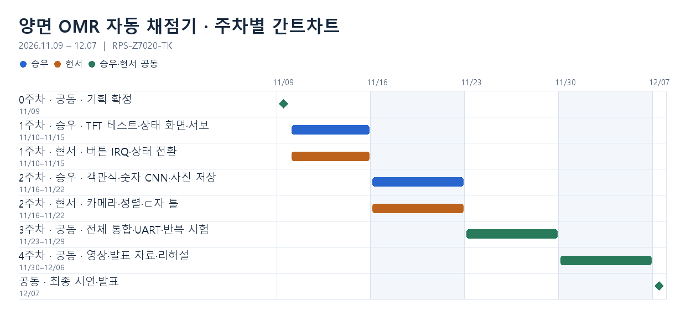

# 양면 OMR 자동 채점기

- **기간** 2026년 11월 9일–12월 7일
- **팀** 승우, 현서
- **완성 범위** 앞면 객관식 10문항, 뒷면 숫자 단답형 2문항, 자동 뒤집기, 앞뒤 사진 저장, 학생별 채점과 전체 집계

버튼 배치, 화면, 상태 전이와 데이터 흐름은 [시스템 아키텍처](docs/system-architecture.md)에 정리했다.

## 주차별 분담과 완료 기준

| 기간 | 승우 | 현서 | 완료 기준 |
|---|---|---|---|
| **0주차 · 11/09** | 보드·카메라·서보 확보 일정 확인. 카메라 높이와 ㄷ자 틀의 회전축 구상. | 버튼 3개, 상태도, 표시 화면, 학생별 저장 형식 정의. | 버튼 동작과 AXI4-Lite로 주고받을 상태·데이터를 함께 확정. |
| **1주차 · 11/10–11/15** | ① TFT 테스트 패턴과 모서리 가이드 출력. ② 채점·전체 집계·초기화 상태별 TFT 화면. ③ 서보 PWM으로 앞·뒷면 위치와 복귀 시험. | 버튼 3개 디바운스와 인터럽트 요청(IRQ) 확인. 임시 READY·캡처 완료·점수로 상태 전환과 자동 IDLE 복귀 구현. Text LCD·7-segment 표시 확인. | 카메라 없이 세 버튼으로 각각 화면을 바꾸고, 표시 시간이 지나면 자동으로 IDLE 복귀. |
| **2주차 · 11/16–11/22** | 실제 영상과 버튼 흐름에 객관식 채점 연결. 뒷면 1~3자리 분리, CNN 학습과 ARM 추론 구현. 앞뒤 사진 두 장을 같은 채점 건으로 SD에 저장. | 카메라·TFT 실영상과 모서리 정렬 판정. ㄷ자 틀에서 앞면 촬영·회전·뒷면 촬영·복귀 시험. PL의 앞면 마킹 집계와 뒷면 답란 잘라내기. | 모서리가 허용 오차 안에 들어오면 READY. 버튼 1로 두 장 저장·채점, 2로 집계, 3으로 초기화. `7`, `07`, `007`은 모두 정수 7로 채점. |

| 기간 | 승우·현서 공동 작업 | 완료 기준 |
|---|---|---|
| **3주차 · 11/23–11/29** | 카메라·서보·버튼·표시장치 통합. UART에서 전체 응시자 수와 학번·이름 입력. SD에 RTC 시각·앞뒤 사진·채점 결과를 학생별로 연결. 반복 뒤집기, 연속 버튼 입력, 정렬 이탈, 집계 초기화 후 복귀 시험. 학습에 쓰지 않은 필체의 인식 정확도와 재확인 비율 측정. | 학번 입력부터 양면 채점, 개인별 저장, 중복 학번을 제외한 전체 집계까지 한 번에 시연. |
| **4주차 · 11/30–12/06** | 전체 동작 영상 촬영. 시스템 구조도·버튼 상태도·CNN 흐름·실측 결과를 발표 자료로 정리. 시연 세팅과 발표 리허설. | 12/06까지 시연본과 발표 자료 확정. |
| **12/07** | 최종 시연·발표. | 준비 → 채점 → 전체 집계 → 초기화 흐름을 실보드로 시연. |

2주차에는 실물 카드와 강의용 카메라로 같은 촬영 높이에서 앞면 마킹과 뒷면 숫자 획이 모두 읽히는지 확인한다.
