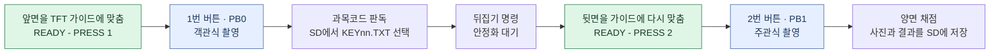
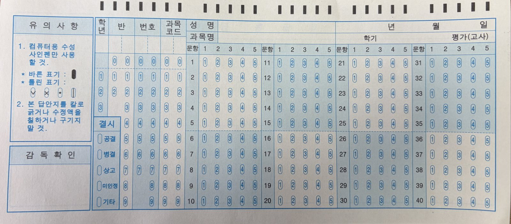

# 양면 OMR 자동 채점기

RPS-Z7020-TK와 OV5640 카메라로 **앞면 객관식 10문항**, **뒷면 숫자 단답형 2문항**을 채점한다. TFT에서 카드 위치를 맞춘 뒤 1번으로 앞면을 찍고, 뒤집힌 카드를 다시 맞춘 뒤 2번으로 뒷면을 찍는다. 앞면에서 두 자리 과목코드를 읽어 SD 카드의 과목별 정답지를 고른다. 두 사진과 결과는 학번별로 SD 카드에 저장된다.

## 조작 흐름

| 버튼 | 동작 |
| --- | --- |
| **1번 · PB0** | 앞면 `READY`에서 객관식 촬영 |
| **2번 · PB1** | 뒷면 `READY`에서 주관식 촬영 후 양면 채점 |
| **3번 · PB2** | IDLE에서 이번 회차의 전체 집계 표시 |
| **4번 · PB3** | IDLE에서 새 회차 시작. 뒷면 대기 중에는 현재 채점 취소 |

가이드 밖에서는 촬영 버튼을 눌러도 해당 면을 저장하지 않는다. 정렬이 맞으면 TFT 가이드가 빨강에서 초록으로 바뀐다.

## 실제 OMR 카드

[주관식 뒷면 사진과 두 답란 위치](docs/omr-card.md#뒷면-주관식-답란)

상단 검은 막대 **27개** 중 **8~12번째**를 객관식 보기 1~5의 기준으로 삼아 첫 번째 문항 묶음인 **1~10번**을 읽는다. [사진의 판독 위치와 좌표 계산](docs/omr-card.md)

## 과목코드

| 코드 | 과목 | SD 카드 정답 파일 |
| --- | --- | --- |
| `01` | 국어 | `KEY01.TXT` |
| `02` | 수학 | `KEY02.TXT` |
| `03` | 영어 | `KEY03.TXT` |
| `04` | 한국사 | `KEY04.TXT` |
| `05` | 통합과학 | `KEY05.TXT` |
| `06` | 통합사회 | `KEY06.TXT` |

## 빌드 및 검증

Vivado 2019.1에서 `.bit`와 `.hdf`를, Xilinx SDK 2019.1에서 ARM용 `.elf`를 생성한다. SD 카드의 `KEY.TXT`에는 공통 과목코드 위치를 넣고, `KEY02.TXT` 같은 과목별 파일에 정답·배점·답란 좌표를 넣는다. [빌드 및 SD 카드 설정](term_project/README.md)

첨부 사진으로 빈칸·단일 마킹·복수 마킹을 확인했고, 시뮬레이션으로 양면의 가이드 밖 촬영 차단을 확인했다. 통합 비트스트림은 타이밍을 통과했고 ARM 앱도 빌드했다. 뒷면 답란 위치의 실물 보정과 실보드·서보 동작 시험은 남아 있다. 서보 없이 확인할 때는 앞면 촬영 후 손으로 뒤집어 진행할 수 있다.

[시스템 구조와 상태도](docs/system-architecture.md) · [개발 일정](docs/schedule.md)
