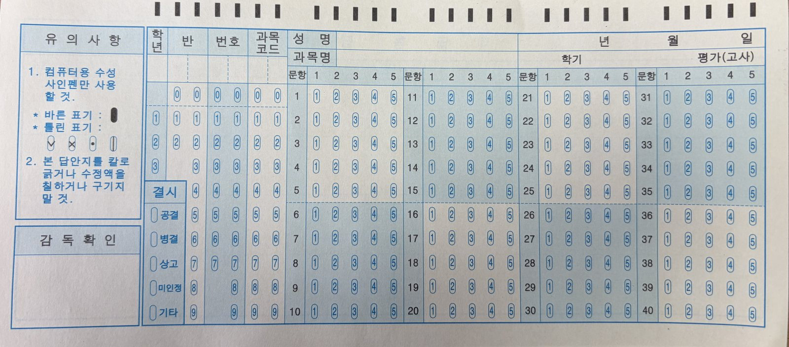
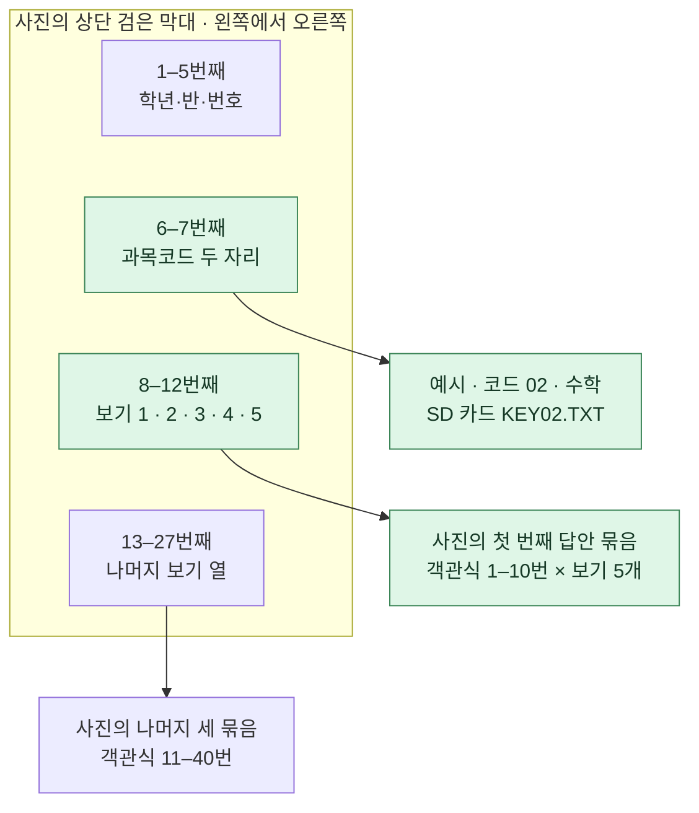
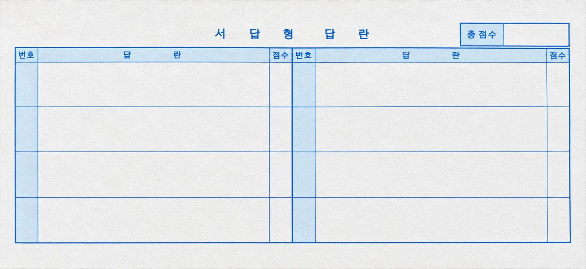

# OMR 카드와 촬영 기준

## 앞면에서 읽는 영역

사진 위쪽의 검은 막대는 왼쪽부터 **기입란 7개**와 **답안 보기 5개씩 네 묶음**으로 배열돼 있다. 앞면 채점은 첫 번째 답안 묶음에 해당하는 막대 8~12번째에서 보기 1~5의 열을 잡고, 아래로 내려가며 문항 1~10의 마킹을 읽는다.

막대 간격과 줄의 기울기, 과목별 `KEYnn.TXT`의 첫 행 오프셋과 행 간격으로 50개 칸의 중심을 계산한다. 그 중심에서 검은 잉크를 집계해 파란 인쇄와 마킹을 구분한다. 막대 배열이 맞지 않으면 재촬영을 안내하고, 복수 마킹이나 애매한 마킹은 재확인으로 처리한다.

## 학년·반·번호 읽기

상단 검은 막대 1번째는 학년, 2·3번째는 반 두 자리, 4·5번째는 번호 두 자리다. 각 열에서 한 칸씩 칠한다. 예를 들어 **1학년 02반 03번**의 수학(02) 결과 저장 경로는 `DATA/S02/G1C02N03/`이다. 같은 번호라도 학년이나 반이 다르면 다른 학생으로 집계한다. 같은 학생이 통합사회(05)도 응시하면 `DATA/S05/G1C02N03/`에 별도로 저장되고, 3번 집계에서 두 과목 점수가 같은 학생 화면에 표시된다.

## 과목코드 읽기

사진에서 `번 호` 오른쪽의 **과목코드** 두 열을 사용한다. 각 열에서 0~9 중 하나만 칠한다. 왼쪽에 `0`, 오른쪽에 `2`를 칠하면 `02`(수학)이고, SD 카드의 `KEY02.TXT`가 선택된다. 지원 과목은 [과목코드 표](../README.md#과목코드)에 있다. 현재 코드 `05`는 통합사회(`KEY05.TXT`), `06`은 통합과학(`KEY06.TXT`)이다. 코드 칸의 행 좌표는 공통 `KEY.TXT`에서 설정한다.

## 뒷면 주관식 답란

두 번째 사진을 기준으로 기울기와 밝기를 보정했다. 예시 설정은 **왼쪽 답란의 첫째 줄과 둘째 줄**에 숫자 단답형 1번과 2번을 적는 배치다. 파란 테두리, 번호 칸, 점수 칸은 판독 영역에서 뺀다.

480×272 프레임에서 카드가 왼쪽 위 `(29, 39)`부터 `422×194` 픽셀을 차지하는 경우, `KEY.example.txt`의 2·3행은 각각 `62 89 216 111`, `62 122 216 144`다. 원본과 보정 사진을 이 위치에 배치한 시험에서 두 칸 모두 미기입으로 판정됐다. 실물 카메라의 거리와 위치에 맞춰 이 좌표를 다시 맞춘다.

## TFT 가이드 사용

- 어두운 무광 배경 위에서 카드 전체를 가이드 안에 맞춘다. 앞면은 검은 막대가 화면 위쪽에 오게 놓는다.
- 초록 가이드와 `READY - PRESS 1`이 보이면 **1번**으로 앞면을 촬영한다.
- 뒤집기 후 뒷면 전체를 다시 맞춘다. 초록 가이드와 `READY - PRESS 2`가 보이면 **2번**으로 뒷면을 촬영한다.
- 뒷면 두 답란의 내부 픽셀 좌표는 과목별 `KEYnn.TXT`에서 정한다. 두 좌표는 실제 뒷면 양식으로 보정해야 한다.

[조작·빌드 안내](../term_project/README.md) · [시스템 구조와 상태도](system-architecture.md)
