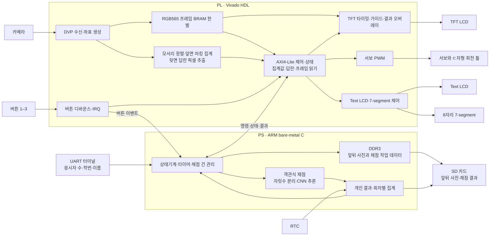
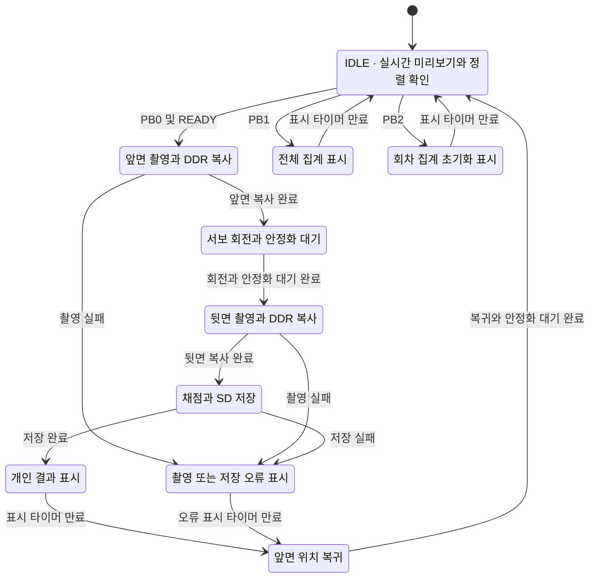

# 양면 OMR 자동 채점기 시스템 아키텍처

- **대상 보드** HUINS RPS-Z7020-TK (`xc7z020clg484-1`)
- **개발 환경** Vivado 2019.1, Xilinx SDK bare-metal C
- **기본 범위** 앞면 10문항×5지선다, 뒷면 숫자 단답형 2문항, 1~999 인식, 한 카메라와 서보를 이용한 양면 촬영

날짜와 담당자는 [개발 일정](../README.md)에 정리했다.

## 전체 구조

- **PL**은 카메라 픽셀을 받아 정렬 여부와 앞면의 50칸 마킹 집계값을 만들고, 뒷면의 답란 픽셀을 PS에 제공한다. 버튼 입력은 디바운스 후 IRQ로 전달한다.
- **PS**는 버튼 이벤트와 타이머로 촬영·회전·채점 순서를 제어한다. UART에서 전체 응시자 수와 학번·이름을 받고, RTC 시각을 붙인 개인 결과와 사진을 SD에 저장한다.
- **CNN**은 PC에서 학습한 0~9 모델을 ARM에서 추론한다. 뒷면 답란별로 1~3자리를 나눈 뒤 각 자리의 이미지를 정규화해 입력한다. `7`, `07`, `007`은 같은 정수 7로 채점한다. 빈칸은 미기입, 범위 밖 숫자나 불확실한 판독은 재확인으로 처리한다.

## 버튼과 화면

| 입력 | 동작 | 표시 |
|---|---|---|
| **IDLE** | 카드를 앞면 위치에 놓고 모서리가 가이드의 허용 오차 안에 들어오는지 확인. | TFT 실영상과 모서리 가이드. 정렬이 맞으면 Text LCD에 `READY`. |
| **버튼 1 · PB0** | READY에서 앞면 촬영 → DDR 복사 → 서보 회전·안정 → 뒷면 촬영·DDR 복사 → 채점과 SD 저장. | TFT에 개인 채점 결과와 판독 표시. 표시 시간이 지나면 앞면 위치로 복귀하고 IDLE로 전환. |
| **버튼 2 · PB1** | 이번 회차 전체 집계 조회. | TFT 전체 집계, Text LCD 요약, 7-segment에 전체 응시자 수 4자리와 집계 인원 수 4자리. 표시 시간이 지나면 IDLE. |
| **버튼 3 · PB2** | 이번 회차의 집계를 초기화. | TFT에 초기화 완료, Text LCD와 7-segment에 초기 상태. 표시 시간이 지나면 IDLE. |

버튼 2·3은 IDLE에서 받고, 촬영·회전·저장이 진행되는 동안에는 새 채점 요청을 받지 않는다. **전체 응시자 수**는 UART 사전 설정값이고, **집계 인원 수**는 이번 회차에서 채점과 저장이 완료된 고유 학번 수다. SD의 사진과 개인 결과는 회차별로 관리한다.

## 프레임 저장과 통합 검증

- 480×272 RGB565 프레임은 한 장에 **255 KiB**다. PL 프레임 BRAM은 한 벌을 재사용하고, **앞면을 덮어쓰기 전에 PS DDR3로 복사**한다. 뒷면도 DDR3로 복사한 뒤 두 사진과 채점 데이터를 한 건으로 SD에 저장한다.
- TFT와 PS의 프레임 읽기는 같은 BRAM의 읽기 경로를 공유하므로, 캡처 완료 시 쓰기를 고정하고 읽기 접근을 중재한다. 카메라 픽셀 클록, TFT 픽셀 클록과 AXI 클록 사이의 완료 신호와 데이터 전달을 각각 검증한다.
- 기존 예제에서 `Y18`을 `resetn`으로 쓰는 제약과 인터럽트 예제의 `PB0`가 겹친다. 통합 XDC에서는 `Y18`을 `PB0`로 지정하고 시스템 리셋은 별도 신호로 구성한다.
- 업체 카메라→TFT 배치 리포트는 BRAM **60/140**개를 사용한다. 현재 20칸 OMR 초안의 Vivado 2019.1 단독 합성은 LUT **258/53,200**, 레지스터 **468/106,400**을 사용했다. 통합 설계는 배치·배선 후 자원과 타이밍을 다시 확인하고, 실보드에서 서보 안정화·CNN 추론·SD 저장 시간을 측정한다.
