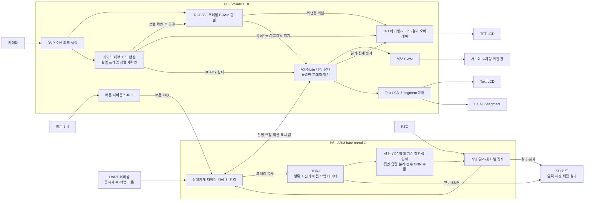
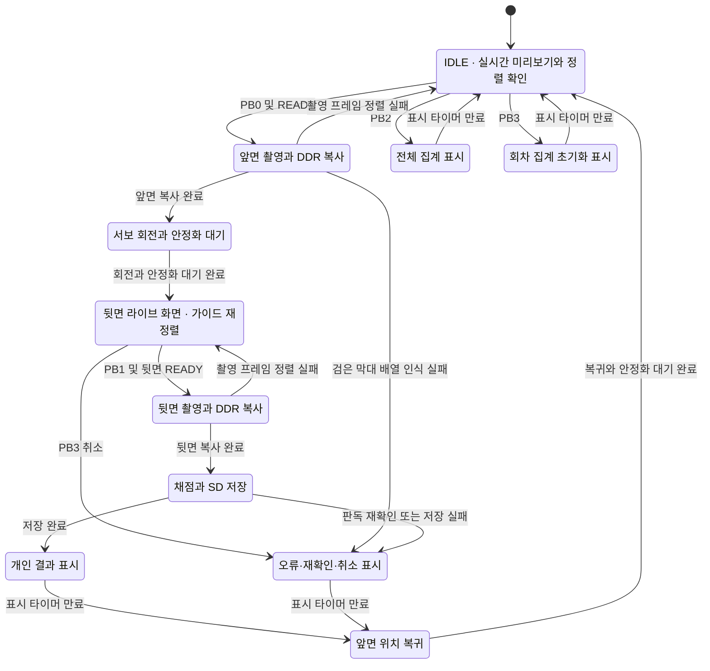

# 양면 OMR 자동 채점기 시스템 아키텍처

- **대상 보드** HUINS RPS-Z7020-TK (`xc7z020clg484-1`)
- **개발 환경** Vivado 2019.1, Xilinx SDK bare-metal C
- **기본 범위** 앞면 10문항×5지선다, 뒷면 숫자 단답형 2문항, 1~999 인식, 한 카메라와 서보를 이용한 양면 촬영

날짜와 담당자는 [개발 일정](schedule.md)에 정리했다.

## 전체 구조

- **PL**은 카메라 영상을 받아 카드가 TFT 가이드 안에 들어왔는지 판정한다. 앞면과 뒷면 모두 실제 촬영할 프레임의 정렬 상태를 다시 확인한 뒤에만 BRAM 쓰기를 동결한다. 버튼 입력은 디바운스 후 IRQ로 전달한다.
- **PS**는 버튼 이벤트와 타이머로 촬영·회전·채점 순서를 제어한다. UART에서 전체 응시자 수와 학번·이름을 받고, RTC 시각을 붙인 개인 결과와 사진을 SD에 저장한다.
- **뒷면**은 `KEY.TXT`에 설정된 두 답란에서 1~3자리 숫자를 분리한다. ARM의 정수 CNN으로 자리별 숫자를 추론하며, `7`, `07`, `007`은 같은 정수 7로 채점한다. 판독이 불확실하면 앞뒤 사진과 `REVIEW.TXT`를 남기고 완료 집계에서 제외한다. 모델은 UCI Optdigits 학습 데이터로 훈련했다. 별도 시험 세트에서 1,797개 중 1,705개를 채택했고, 채택분 정확도는 97.48%였다. 실제 뒷면 촬영 영상의 정확도는 아직 측정하지 않았다. [UCI Optdigits](https://doi.org/10.24432/C50P49)

## 버튼과 화면

| 입력 | 동작 | 표시 |
|---|---|---|
| **IDLE** | 검은 막대가 위로 오게 카드를 놓고 앞면 전체를 네모 가이드 안에 맞춘다. | TFT 가이드가 빨강에서 초록으로 바뀌고 Text LCD에 `READY - PRESS 1`. |
| **버튼 1 · PB0** | 앞면 `READY`에서 객관식 촬영·DDR 복사·뒤집기를 시작한다. | Text LCD에 `READY - PRESS 1`. 뒤집기 후 뒷면 정렬 화면으로 전환한다. |
| **버튼 2 · PB1** | 뒤집기 안정화 후 뒷면 `READY`에서 주관식 촬영을 시작한다. | Text LCD에 `READY - PRESS 2`. 채점·저장 후 점수를 표시하고 앞면으로 복귀한다. |
| **버튼 3 · PB2** | 이번 회차 전체 집계 조회. | TFT 전체 집계, Text LCD 요약, 7-segment에 전체 응시자 수 4자리와 집계 인원 수 4자리. 표시 시간이 지나면 IDLE. |
| **버튼 4 · PB3** | IDLE에서 새 회차를 시작하고, 뒷면 정렬 중에는 진행 중인 채점을 취소한다. | TFT에 초기화 완료, Text LCD와 7-segment에 초기 상태. 표시 시간이 지나면 IDLE. |

각 촬영 버튼은 해당 면의 정렬 대기 상태에서 `READY`일 때만 동작한다. 집계와 새 회차는 IDLE에서 실행한다. 촬영·저장 중 입력은 다음 동작에 넘기지 않는다. **전체 응시자 수**는 UART 사전 설정값이고, **집계 인원 수**는 이번 회차에서 채점과 저장이 완료된 고유 학번 수다. SD의 사진과 개인 결과는 회차별로 관리한다.

## 앞면 객관식 좌표

[실제 OMR 카드 사진과 판독 영역](omr-card.md)

네모 가이드는 카드가 화면 안에 들어왔는지 판단한다. 답안 칸 좌표는 동결한 사진의 **상단 검은 막대 27개**에서 구한다. 학년·반·번호·과목코드 영역의 막대 7개를 건너뛰고, 그다음 막대 5개를 객관식 **1~10번**의 1~5번 보기 열에 매핑한다. 뒤의 11~40번 영역은 채점 범위에서 제외한다.

막대 간격과 기울기 및 `KEY.TXT`의 첫 행 오프셋·행 간격으로 50개 마킹 위치를 계산한다. 각 칸 중심의 검은 잉크 비율을 집계하고 파란색 인쇄를 걸러낸다. 막대 배열이 맞지 않으면 재촬영하고, 복수 마킹이나 경계값은 재확인으로 처리한다.

## 프레임 저장과 통합 검증

- 480×272 RGB565 프레임은 한 장에 **255 KiB**다. PL 프레임 BRAM은 한 벌을 재사용하고, **앞면을 덮어쓰기 전에 PS DDR3로 복사**한다. 뒷면도 DDR3로 복사한 뒤 두 사진과 채점 데이터를 한 건으로 SD에 저장한다.
- TFT와 PS의 프레임 읽기는 같은 BRAM의 읽기 경로를 공유하므로, 캡처 완료 시 쓰기를 고정하고 읽기 접근을 중재한다. 카메라 픽셀 클록, TFT 픽셀 클록과 AXI 클록 사이의 완료 신호와 데이터 전달을 각각 검증한다.
- 기존 예제에서 `Y18`을 `resetn`으로 쓰는 제약과 인터럽트 예제의 `PB0`가 겹친다. 통합 XDC에서는 `Y18`을 `PB0`로 지정하고 시스템 리셋은 별도 신호로 구성한다.
- 첨부된 앞면 사진을 480×272에 배치하여 빈 답안, 합성 단일 마킹 10개 및 복수 마킹을 확인했다. 실제 카메라의 조명과 설치 높이에서 앞면 행 간격, 뒷면 답란 좌표, 회전 위치를 보정한다. 통합 배치·배선에서 사용자 지정 타이밍 제약을 충족했고, BRAM 64/140개를 사용했다. 서보 실물 테스트는 현재 범위에서 보류했다.
